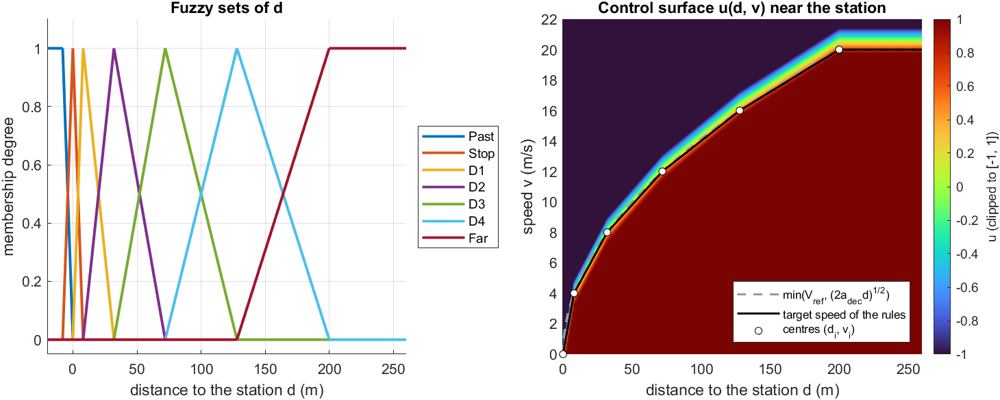
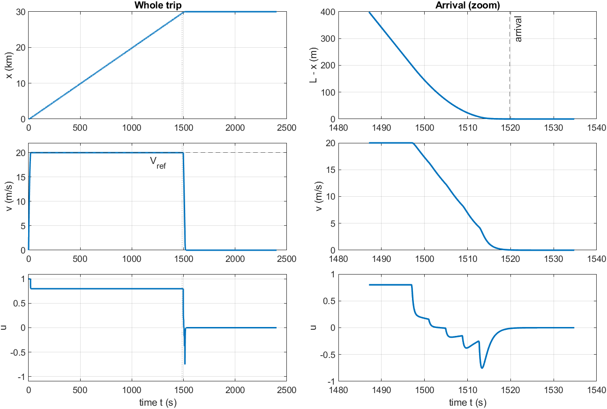
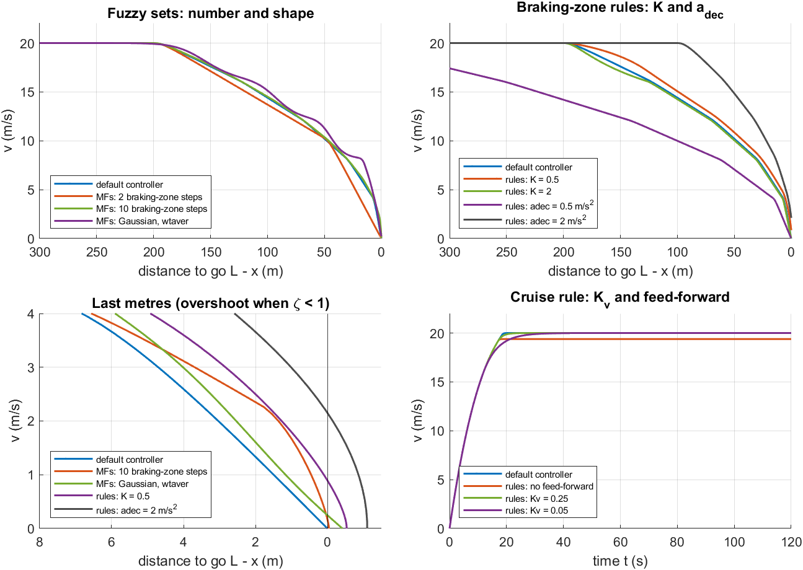
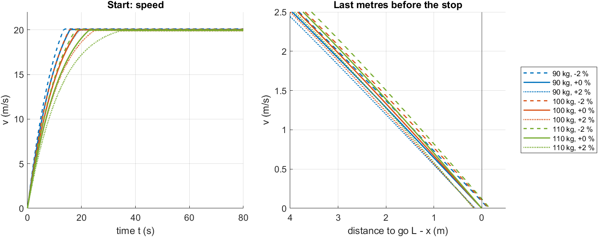
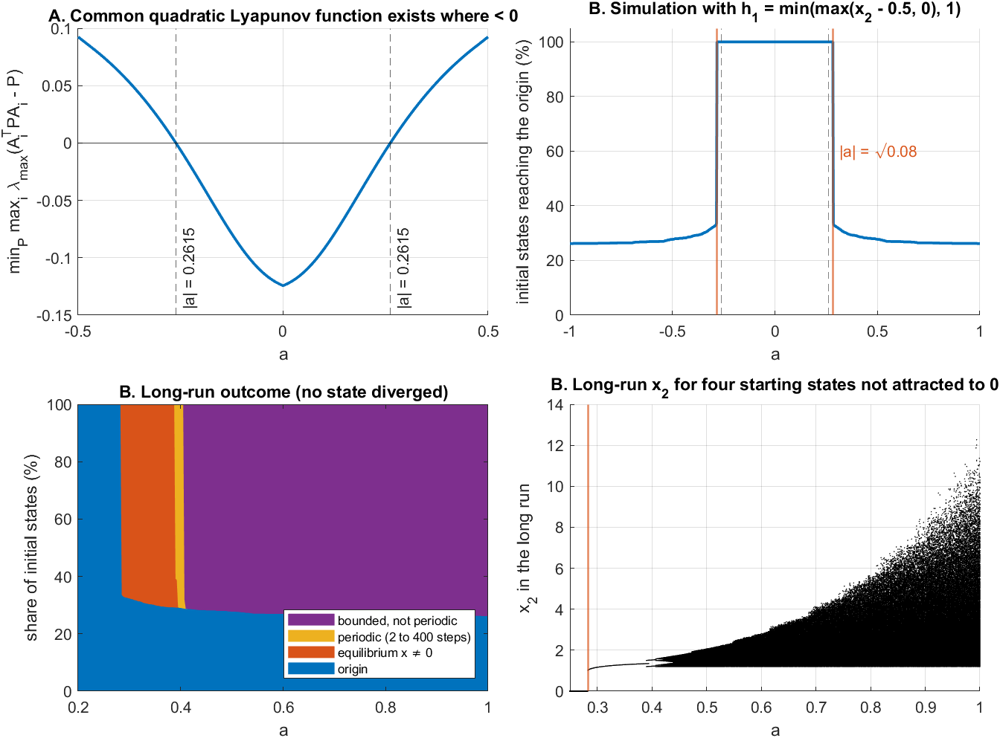
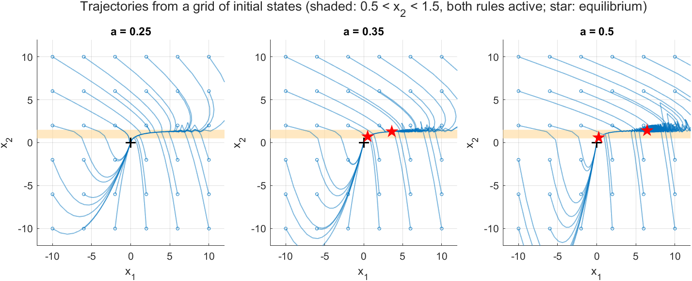

# Fuzzy control of an electric train and stability of a Takagi-Sugeno system (MATLAB)

A Takagi-Sugeno fuzzy controller that drives an electric train from one station to the next at a reference speed and stops it without overshoot, plus a stability study of a two-rule discrete-time Takagi-Sugeno system.


This was assignment 1 of the course *Neuro-Fuzzy Control and Applications* (coursework, 2023-2024). Author: Konstantinos Vaios Chronis.

<p align="center"></p>

## Results at a glance

| Quantity | Value |
|---|---|
| Controller | first-order Takagi-Sugeno, 7 rules on the distance to the station |
| Nominal trip (30 km at 20 m/s) | arrival in 1519.8 s, 8.6 s more than the fastest possible trip; no overshoot |
| Input and braking | \|u\| ≤ 1 throughout, strongest braking 1.72 m/s² |
| Damping of the stop | ζ = 1.13 (100 kg), between 1.08 and 1.19 for 90 to 110 kg |
| Mass ±10 % | speed 19.96 to 20.04 m/s, stop exactly at the station |
| Slope ±2 % | speed within 0.121 m/s, stop within 0.168 m of the station (formula: m g sin θ / (b K_p)) |
| Common quadratic Lyapunov function (Theme 2A) | exists for \|a\| < 0.2615 |
| Global convergence with the given membership function (Theme 2B) | for \|a\| < √0.08 ≈ 0.2828; other equilibria exist for \|a\| ≥ √0.08 |

## Contents

- [The task](#the-task)
- [What I did](#what-i-did)
- [Results](#results)
- [Repository structure](#repository-structure)
- [Getting started](#getting-started)
- [References](#references)
- [Sources and credits](#sources-and-credits)
- [License](#license)

## The task

This summary is in English; the original statement is in Greek and is not included here.

**Theme 1: fuzzy control of an electric train.** The train moves on a straight track, with position x and speed v:

```
m dv/dt = −(a1 + m a2) v − a3 v|v| + b u − m g sin θ
```

with m = 100, a1 = 1, a2 = 0.05, a3 = 0.1, b = 200 and a level track (θ = 0). The specifications: travel between the stations at a reference speed, arrive quickly and without overshoot, and keep |u| ≤ 1.

- **A.** Design a fuzzy controller (Mamdani or Takagi-Sugeno rules) that meets the specifications.
- **B.** Study how the closed loop depends on the controller: membership functions, rules and inference.
- **C.** Check the specifications when the mass changes by 10 % and an external force (a slope) acts.

The station distance (L = 30 km) and the reference speed (20 m/s) are my own choice; the statement leaves them open.

**Theme 2: stability of a Takagi-Sugeno system.** The discrete-time system is

```
x(k+1) = h1(x) A1 x(k) + h2(x) A2 x(k),   h1 + h2 = 1,
A1 = [0.9 a; 0 0.8],   A2 = [0.9 0; a 0.8]
```

- **A.** For which a can stability be proved with a common quadratic Lyapunov function V = xᵀPx?
- **B.** For which a is the system asymptotically stable when h1(x) = min(max(x2 − 0.5, 0), 1)?

**In plain words.** A *fuzzy controller* uses rules such as "if the station is near, slow down", where "near" is a set with soft edges. In a *Takagi-Sugeno* controller each rule outputs a formula instead of a fixed value, and the controller blends the formulas of the rules that apply. A *Lyapunov function* is an energy-like quantity that keeps shrinking along every motion of the system; finding one proves that the system settles at the origin.

## What I did

### Theme 1: the controller

The controller has two inputs, the distance to the station d = L − x and the speed v. The rules look only at the distance. They describe a braking profile with a constant deceleration of 1 m/s²: at the distances d_i = 0, 8, 32, 72, 128 and 200 m the target speeds are v_i = 0, 4, 8, 12, 16 and 20 m/s. There is a triangular fuzzy set around each d_i (Stop, D1 to D4, Far), and a set Past for a train that has gone past the stop.

| Rule | Output u |
|---|---|
| d is Far | u_ff(20) + K (20 − v) |
| d is D_i | u_ff(v_i) + K (v_i − v) |
| d is Stop | −K v |
| d is Past | the mirror image of D1, which brings the train back |

Here u_ff(v) = ((a1 + m a2) v + a3 v²)/b is the input that holds the speed v on a level track (a feed-forward term), and K = 1.25 s/m. The sets add up to 1 and every rule has the same gain, so the controller works out to

```
u = ū_ff(d) + K (v̂(d) − v)
```

a speed controller that follows v̂(d), the piecewise-linear target speed through the points (d_i, v_i). The control surface is smooth: u changes by 1.25 per m/s of speed error and by at most 0.641 per metre of distance. Outside a band 1.6 m/s wide near the target speed, u is at its limit of ±1 (full power or full braking), which is what the right-hand plot above shows.

**Why there is no overshoot.** In the last 8 m only the rules Stop and D1 act, and u = K_p d − K v with K_p = 0.641 per metre. That makes the stop a linear second-order system with damping ratio

```
ζ = (a1 + m a2 + b K) / (2 √(m b K_p))
```

which is 1.13 for the nominal train and stays above 1 (between 1.08 and 1.19) for 90 to 110 kg. A damping ratio above 1 means the distance goes to zero without swinging past it. ζ falls as the mass grows, and at 110 kg ζ ≥ 1 needs K ≥ 1.07. K = 1.25 leaves a margin; a larger K would make the control surface steeper.

### Theme 1: parameter study and robustness

`run_theme1.m` changes one setting at a time: the number of fuzzy sets in the braking zone (2 or 10 steps instead of 5), Gaussian instead of triangular sets, weighted sum instead of weighted average, the gain K, the braking rate of the profile, the feed-forward term and the gain of the Far rule. It then runs the default controller with 90, 100 and 110 kg on slopes of −2 %, 0 and +2 %.

### Theme 2: stability

**A.** A common P > 0 with A_iᵀ P A_i − P < 0 for both rules exists exactly when f(a) < 0, where f(a) is the smallest possible largest eigenvalue of A_iᵀ P A_i − P over all P ≥ 0 with trace 1. This is a convex problem in P, so a grid search followed by `fminsearch` finds the minimum without an LMI solver (`lyapunov_margin.m`). Bisection on a gives the limit.

**B.** Near the origin x2 < 0.5, so h1 = 0 and only A2 acts. A2 has eigenvalues 0.9 and 0.8, so the origin is locally asymptotically stable for every a. A point x ≠ 0 is an equilibrium when det(h1 A1 + h2 A2 − I) = 0.02 − h1 h2 a² = 0. Because h1 h2 ≤ 1/4, such points exist exactly when a² ≥ 0.08. They lie in the band 0.5 < x2 < 1.5, at x2 = 0.5 + h1 and x1 = 10 h1 a x2. The script checks this by simulating 1440 initial states (a 21 × 21 grid on [−10, 10]² and 1000 random states on [−100, 100]²) for 20,000 steps, with a from 0 to 1 in steps of 0.0025. It sorts the end states into: the origin, another equilibrium, a periodic orbit, bounded non-periodic motion, or divergence. All results are symmetric in the sign of a.

## Results

All numbers come from `matlab/run_theme1.m` and `matlab/run_theme2.m`. Their printed output is in `results/`.

### Theme 1

<p align="center"></p>

The train accelerates at full power, cruises at 20.000 m/s and arrives after 1519.8 s. The fastest trip possible with |u| ≤ 1 (full power, cruise, full braking) takes 1511.2 s. The position never passes the station and the speed never goes negative. The small steps in u during braking come at the points d_i, where the slope of the target-speed profile changes.

| Setting (nominal train) | Arrival (s) | Overshoot (m) | ζ |
|---|---|---|---|
| Default controller | 1519.8 | 0 | 1.13 |
| 2 steps in the braking zone | 1531.8 | 0 | 1.79 |
| 10 steps in the braking zone | 1516.5 | 0.042 | 0.80 |
| Gaussian sets | 1519.0 | 0.417 | 1.13 |
| K = 0.5 | 1520.3 | 0.536 | 0.73 |
| K = 2 | 1520.8 | 0 | 1.42 |
| Braking profile 0.5 m/s² | 1535.0 | 0 | 1.60 |
| Braking profile 2 m/s² | 1514.4 | 1.108 | 0.80 |
| No feed-forward term | 1567.5 | 0 | 1.14 |

<p align="center"></p>

- **Every setting with ζ < 1 overshoots, and every setting with ζ > 1 does not.** Ten steps put the set D1 very close to the stop, which raises K_p and lowers ζ. More rules are not always better.
- **Gaussian sets never reach zero** (their degrees add up to between 0.56 and 1.31), so the rule D1 still pushes at the stop and the train stops 0.417 m past it.
- **Without the feed-forward term** the proportional gain alone cannot hold 20 m/s; the train cruises at 19.38 m/s.
- **Inference.** Each rule has a single premise, so the AND operator does not matter. With triangular sets the weighted sum gives exactly the same result as the weighted average, because the degrees add up to 1.

<p align="center"></p>

| Mass (kg) | Slope | Arrival (s) | Cruise speed (m/s) | Final position − L (m) |
|---|---|---|---|---|
| 90 | 0 | 1516.3 | 20.039 | 0 |
| 110 | 0 | 1523.5 | 19.962 | 0 |
| 110 | −2 % (downhill) | 1516.0 | 20.044 | +0.168 |
| 110 | +2 % (uphill) | 1531.7 | 19.879 | −0.168 |

With a different mass the train still stops exactly at the station. On a slope it stops a little short (uphill) or a little past the station (downhill), because the controller has no integral action. The simulated offset matches the formula m g sin θ / (b K_p) = 0.168 m, and it stays inside the 0.5 m stopping tolerance. The steepest uphill on which the motor can still hold 20 m/s with 110 kg is 2.78 %.

### Theme 2

<p align="center"></p>

- **A.** A common quadratic Lyapunov function exists for |a| < 0.2615. For a = 0.2, for example, P = [1.3534 0.2184; 0.2184 1.1350] gives a largest eigenvalue of −0.0879.
- **B.** Every one of the 1440 initial states reaches the origin for |a| ≤ 0.2825, the last value in the scan below √0.08 = 0.2828. From a = 0.285, some of them stop at the predicted equilibria (at a = 0.29 they end within 1.8·10⁻¹⁴ of them). Periodic orbits appear from a = 0.39, and bounded non-periodic motion from a = 0.4075. No state diverged for any a.

<p align="center"></p>

**Answer.** The origin is locally asymptotically stable for every a. It is globally asymptotically stable (from every initial state tested) for |a| < √0.08 ≈ 0.2828, and not for |a| ≥ √0.08, where other equilibria exist. That limit is wider than 0.2615 from part A. The Lyapunov test in A must hold for every possible membership function, so it is only sufficient, and here it is conservative.

## Repository structure

```
fuzzy-train-control/
├── README.md
├── matlab/
│   ├── train_params.m       train and trip parameters
│   ├── train_fis.m          the Takagi-Sugeno controller (sets, rules, settings)
│   ├── simulate_train.m     closed-loop simulation and performance measures
│   ├── run_theme1.m         Theme 1: nominal trip, parameter study, robustness, figures 1-4
│   ├── lyapunov_margin.m    common quadratic Lyapunov function for two matrices, no LMI solver
│   └── run_theme2.m         Theme 2: Lyapunov limit, simulations, figures 5-6
├── figures/                 figures made by the two scripts
├── results/                 printed output of the two scripts
└── report/
    └── fuzzy-train-control_report_GR.pdf   report in Greek (10 pages)
```

## Getting started

You need MATLAB (tested with R2024b). Theme 1 needs the Fuzzy Logic Toolbox; Theme 2 needs no toolbox.

```matlab
cd matlab
run_theme1        % a few minutes; writes results/theme1_results.txt and figures 1-4
run_theme2        % over ten minutes (1440 states x 401 values of a x 20,000 steps); writes results/theme2_results.txt and figures 5-6

fis = train_fis('K', 2, 'nNodes', 10);        % a controller with other settings
R = simulate_train(fis, train_params('m', 110, 'grade', 0.02));
```

## References

- T. Takagi and M. Sugeno, *Fuzzy identification of systems and its applications to modeling and control*, IEEE Transactions on Systems, Man, and Cybernetics 15(1), 1985, 116-132.
- K. Tanaka and M. Sugeno, *Stability analysis and design of fuzzy control systems*, Fuzzy Sets and Systems 45(2), 1992, 135-156.
- K. Tanaka and H. O. Wang, *Fuzzy Control Systems Design and Analysis: A Linear Matrix Inequality Approach*, Wiley, 2001.

## Sources and credits

- **Assignment.** The task is assignment 1 of the course *Neuro-Fuzzy Control and Applications* (2023-2024). The problem statement belongs to the course and is not included here. This README only summarizes it.
- **Own work.** The controller design, the stability analysis, the MATLAB code, the figures and the report are the author's own work for this assignment.
- **Tools.** [MATLAB](https://www.mathworks.com/products/matlab.html) with the Fuzzy Logic Toolbox; the report was written in Microsoft Word.

## License

None. This work is shared for viewing only, and all rights are reserved by the author.
